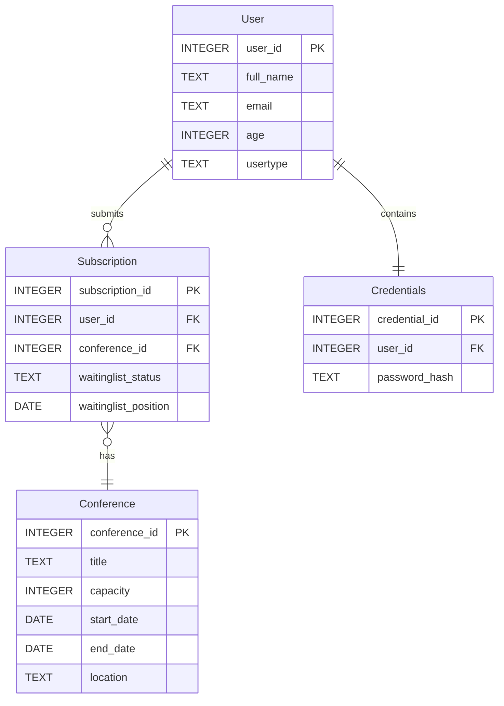

# Deliverable 1 Document
## Project Features
- Persistent user information
- Hashed user passwords
- Password and email format verification on registration/update
- Extensive test suite
- Localized interface
- Sensible checks on real values (e.g. conference capacity cannot be set to a value less than 1)
- Rejection of overlaping registrations
- Conference waiting list in case of a conference's registrations surpassing its capacity, ordered by attempted registration time
- User dashboard displaying:
    - Available conferences with all relevant information
    - Allowing:
        - Users to register for conferences
        - Users to update personal information
        - Users to view registered conferences dashboard
- User conference dashboard allowing:
    - Users to browse registered conferences
    - Cancel conference registrations
- Admin dashboard allowing the admin to:
    - Create conferences
    - Update conference information
    - Delete irrelevant conferences, assuming:
        - No users are actively registerd, or
        - The conference end date has passed
    - View conference reports detailing:
        - Capacity
        - Registered users
        - Waiting list size
    - View user reports detailing:
        - Personal information (not password)
        - Registered  conferences

This project is a model of a conference managment and registration system, written in Java 27. Project dependency is managed thorugh Apache Maven. This project uses a local SQLite database for storing data. The local database is interfaced with through four database access objects (DAO), using sqlite-jdbc version 3.53.4.0. For its graphical user interface (GUI), the project implements JavaFX version 27. The project follows Model-View-Controller (MVC) principles to organize its classes. This means that user input flows from the view (the GUI) down to the controller, which interpretes user input then calls on model methods to perform logical operations. The results of these logical operations are then reflected by changes in the view. In some instances, these logical operations require interactions with the project's local SQLite database; in which case, relevant DAO methods are called to perform these operations within the database itself.

The local SQLite database stores all information regarding users and conferences. This includes, but is not limited to:
- User personal information
- Conference timing and location information
- User registrations to conferences
For more details, please refer to the entity relationship (ER) diagram at the end of this document.

## User Interface Plan
### 1. Login Window
Allows administrators and participants to log in using their email and password. New participants can go to the Sign Up window to create an account.

  

### 2. Sign Up Window
Allows new participants to create an account by entering their full name, email, age, and password. Users can return to the Login window after signing up.

  

### 3. My Profile
Displays the participant's personal information, including their name, email, and age. Participants can update their information and save the changes.

  

### 4. Create/Edit Conference
Allows administrators to create new conferences or edit existing ones. They can enter or update the conference title, capacity, start and end dates and times, and location.

  

### 5.Administrator Panel 
Displays a list of all conferences and their details. The administrator can create, edit, delete, and refresh conferences or open the Administrative Reports window.

  

### 6. My Subscriptions
Displays the participant's confirmed subscriptions and waiting-list entries. Participants can view their registration status and cancel a subscription or waiting-list entry.

  

### 7. Participant Panel
Displays available conferences, including their schedules, capacities, and available seats. Participants can register for a conference, join its waiting list when full, or access My Subscriptions and My Profile.

  

### 8. Administrative Reports
Allows administrators to select and view one of the six available reports. The results appear in a table that changes its columns depending on the selected report. Administrators can also select a specific conference or participant when needed.

  

## Team Members and Responsibilites
> [!IMPORTANT]
> This table is subject to change, both in the distribution of unimplemented features and the specific features listed.

<!-- | featureName | | | -->
| Feature | Mathieu Bernardin | Manal Fayyaz | Mohammad Al Mousa |
| --- | --- | --- | --- |
| Database Access Objects | x | | |
| Password Hashing System | | | |
| Password Format Verification | | | |
| Email Format Verification | | | |
| Canadian English Localisation | | | |
| Canadian French Localisation | | | |
| Overlaping Registration Verification | | | |

| Interface Design | Mathieu Bernardin | Manal Fayyaz | Mohammad Al Mousa |
| --- | --- | --- | --- |
| Interface Mockups | | x | |
| Login Window | | | |
| Sign Up Window | | | |
| My Profile Window | | | |
| Create/Edit Conference Window | | | |
| Administrator Panel Window | | | |
| My Subscriptions Window | | | |
| Participant Panel Window | | | |
| Administrative Reports Window | | | |

| Tests | Mathieu Bernardin | Manal Fayyaz | Mohammad Al Mousa |
| --- | --- | --- | --- |
| Conference DAO | | | x |
| Password DAO | x | | |
| Subscription DAO | | x | |
| User DAO | | | x |
| Other Tests TBD | | | |

## User Stories
### User Account and Login:
- As a participant, I want to create an account using my name, email, age, and password, so that I can register for conferences.
- As a user (participant or administrator), I want to log in with my email and password, so that I can access the features available to me. The administrator account is already created in the database.
- As a participant, I want to edit my personal information, so that I can keep my profile up to date. 
### Conference Management:
- As an administrator, I want to add new conferences with their details, so that participants can see and register for them.
- As an administrator, I want to see a list of all conferences, so that I can keep track of the events.
- As an administrator, I want to edit conference details, so that I can make changes when needed.
- As an administrator, I want to delete a conference only if it has no confirmed subscriptions or waiting-list entries, so that I can remove events that are no longer needed.
- As a participant, I want to browse conferences and see their details, so that I can find the ones I am interested in.
### Subscriptions and Waiting List:
- As a participant, I want to subscribe to a conference when seats are available, so that I can attend the event.
- As a participant, I want to join the waiting list when a conference is full, so that I still have a chance to get a spot.
- As a participant, I want to see the conferences I have subscribed to, so that I can keep track of my registrations.
- As a participant, I want to know whether my subscription is confirmed or on the waiting list, so that I know where I stand.
- As a participant, I want to cancel either a confirmed subscription or a waiting-list entry, so that I can withdraw if I can no longer attend. Cancelling a confirmed spot should trigger a check of the waiting list.
- As a participant, I want the system to stop me from subscribing to the same conference twice, so that I do not accidentally create duplicate registrations.
- As a participant, I want the system to block a subscription or waiting-list entry if the conference overlaps with one of my confirmed conferences, so that I do not have scheduling conflicts.
- As a participant on the waiting list, I want available seats to go to eligible people in the order they joined, so that the process is fair. If the first person has a scheduling conflict with another confirmed conference, the system should skip them, check the next person, and leave the skipped person on the waiting list.
### Reports:
- As an administrator, I want to see how many seats are filled and available in each conference, so that I can check how full the events are.
- As an administrator, I want to see the confirmed participants for a selected conference, so that I know who will be attending.
- As an administrator, I want to see the waiting list for a selected conference in queue order, so that I know who is waiting for a spot.
- As an administrator, I want to check which conferences a participant has subscribed to, so that I can see their confirmed subscriptions and waiting-list entries.
- As an administrator, I want to see the number and percentage of seats filled in each conference, so that I can compare conference occupancy.
- As an administrator, I want to see conferences with no confirmed subscriptions or waiting-list entries, so that I can identify events nobody has signed up for.
### Language:
- As a user, I want to switch between English (Canada) and French (Canada) while using the application, so that I can use my preferred language without losing my information.

## Entity Relationship Diagram

