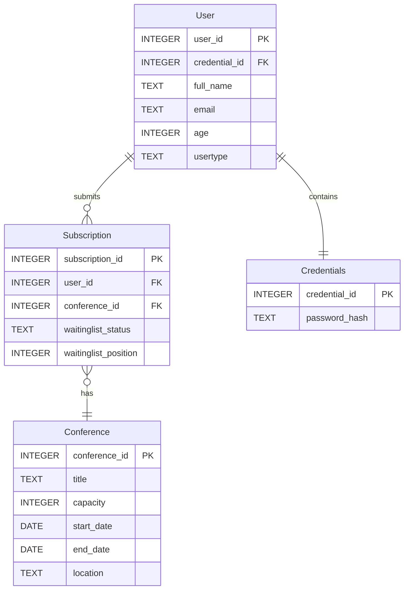

# Deliverable 1 Documents
## Project Features

## User Interface Plan
### 1. Login Window

  

### 2. Sign Up Window

  

### 3. My Profile

  

### 4. Create/Edit Conference

  

### 5.Administrator Panel 

  

### 6. My Subscriptions

  

### 7. Participant Panel

  

### 8. Administrative Reports

  

## Team Members and Responsibilites
| Name | Features |
| --- | --- |
| Mathieu Bernardin | |
| Manal Fayyaz | |

## User Stories
### User Account and Login:
1.	As a participant, I want to create an account using my name, email, age, and password, so that I can register for conferences.
2.	As a user (participant or administrator), I want to log in with my email and password, so that I can access the features available to me. The administrator account is already created in the database.
3.	As a participant, I want to edit my personal information, so that I can keep my profile up to date. 
### Conference Management:
4.	As an administrator, I want to add new conferences with their details, so that participants can see and register for them.
5.	As an administrator, I want to see a list of all conferences, so that I can keep track of the events.
6.	As an administrator, I want to edit conference details, so that I can make changes when needed.
7.	As an administrator, I want to delete a conference only if it has no confirmed subscriptions or waiting-list entries, so that I can remove events that are no longer needed.
8.	As a participant, I want to browse conferences and see their details, so that I can find the ones I am interested in.
### Subscriptions and Waiting List:
9.	As a participant, I want to subscribe to a conference when seats are available, so that I can attend the event.
10.	As a participant, I want to join the waiting list when a conference is full, so that I still have a chance to get a spot.
11.	As a participant, I want to see the conferences I have subscribed to, so that I can keep track of my registrations.
12.	As a participant, I want to know whether my subscription is confirmed or on the waiting list, so that I know where I stand.
13.	As a participant, I want to cancel either a confirmed subscription or a waiting-list entry, so that I can withdraw if I can no longer attend. Cancelling a confirmed spot should trigger a check of the waiting list.
14.	As a participant, I want the system to stop me from subscribing to the same conference twice, so that I do not accidentally create duplicate registrations.
15.	As a participant, I want the system to block a subscription or waiting-list entry if the conference overlaps with one of my confirmed conferences, so that I do not have scheduling conflicts.
16.	As a participant on the waiting list, I want available seats to go to eligible people in the order they joined, so that the process is fair. If the first person has a scheduling conflict with another confirmed conference, the system should skip them, check the next person, and leave the skipped person on the waiting list.
### Reports:
17.	As an administrator, I want to see how many seats are filled and available in each conference, so that I can check how full the events are.
18.	As an administrator, I want to see the confirmed participants for a selected conference, so that I know who will be attending.
19.	As an administrator, I want to see the waiting list for a selected conference in queue order, so that I know who is waiting for a spot.
20.	As an administrator, I want to check which conferences a participant has subscribed to, so that I can see their confirmed subscriptions and waiting-list entries.
21.	As an administrator, I want to see the number and percentage of seats filled in each conference, so that I can compare conference occupancy.
22.	As an administrator, I want to see conferences with no confirmed subscriptions or waiting-list entries, so that I can identify events nobody has signed up for.
### Language:
23.	As a user, I want to switch between English (Canada) and French (Canada) while using the application, so that I can use my preferred language without losing my information.

## Entity Relationship Diagram

